# it26 vs IT 2.14: third comparison round (mouse)

Run: 2026-10-12. IT 2.14 (`IT /S0`) under QEMU + FreeDOS with the
CuteMouse driver vs it26 master `3ff3671`, remote backend. Left image =
IT 2.14, right = it26.

## How the harness drives the mouse

- **DOS side:** CuteMouse (the FreeDOS driver, `ctmouse.zip` from the
  FreeDOS 1.4 repository) sits in the boot image's `C:\` and is loaded by
  `RUN.BAT` only for scripts that use the mouse: IT 2.14 draws its pointer
  into the text screen (a 3x3 block of redefined characters), which would
  otherwise show up in every capture. QEMU's PS/2 mouse is relative, so
  the harness pushes the pointer into the top-left corner (moves clamp
  there) and then steps to the target. Measured against IT 2.14: 1 count
  = 1 pixel horizontally, 2 counts = 1 pixel vertically (640x400 logical
  pixels), linear up to 4 counts per packet; bigger moves get accelerated.
  Before every capture the pointer is parked bottom-right; cell (49,79),
  where IT still draws a corner of it, is masked.
- **Port side:** the remote backend takes `mouse <px> <py> <b>`; a press
  queues `ITK_MOUSE` like the Win32 backend's `WM_LBUTTONDOWN`, moves and
  the release update the state the editor polls (drags).
- **Scripts:** `click c r`, `clickpx x y`, `drag c0 r0 c1 r1`, `dragpx`,
  `mousemove`, `mousedown`, `mouseup` (see `tools/compare/README.md`).

| Script | Covers |
|---|---|
| `mouse_f12.hds` | F12 buttons, toggles, slider drag, tempo bar |
| `mouse_f3.hds` | F3 list, default/global volume, pan toggle and bar, vibrato waveform buttons and sliders, loop field |
| `mouse_f4.hds` | F4 list, NNA / Duplicate Check buttons, note table, page buttons |
| `mouse_f4_pages.hds` | F4 Volume / Panning sliders and envelope, Pattern Editor Options |
| `mouse_f11.hds` | order list, pan sliders (also on a muted channel), volume page |
| `mouse_palette.hds` | Ctrl-F12 sliders and preset buttons |
| `mouse_menus.hds` | main menu and submenus, Ctrl-Q Cancel, New Song Keep/Clear |
| `mouse_pe.hds` | pattern editor: cells, channel header, row numbers, drag |
| `mouse_misc.hds` | F9 file list / name / drives, a dialog button's border vs label row |

## Matches

Clicked or dragged with the same result as IT 2.14 (values, focus,
colours): F12 Control/Playback/Pitch buttons, the two toggles, the
global volume drag (040) and a click into the tempo bar (192); F3
sample list, default volume drag (016), global volume, default pan toggle
and bar, the square and random waveform buttons, the vibrato sliders, the
loop field; F4 instrument list, all NNA and Duplicate Check buttons, the
note table, the four page buttons, the Volume page sliders (global volume
096); F11 pan and volume sliders (values); the whole palette screen,
including the colours; the main menu, all submenus, the message editor
item, Ctrl-Q Cancel, the New Song buttons (the Variables row aside);
Pattern Editor Options.

## Findings

| # | Finding | Kind |
|---|---|---|
| M1 | Buttons are clickable over their whole box in it26; in IT, normal buttons (box styles 8-15, 24-27) only inside, inset 7 pixels -- in practice the label row | hit area |
| M2 | Pattern editor: IT 2.14 ignores the mouse; it26 moves the cursor to the clicked cell | extra behaviour |
| M3 | F11 order list: IT ignores clicks; it26 moves the order cursor | extra behaviour |
| M4 | F9 / F10 file screens: IT ignores clicks (no mouse events in `IT_DISK.ASM`); it26 selects files, drives, fields | extra behaviour |
| M5 | F11: a click on a muted channel's slider unmutes it in IT and sets the pan; it26 keeps "Muted" | behaviour |
| M6 | F11: the selected channel's label is 23h in IT, 30h in it26 (keyboard focus too) | colour |
| M7 | Menus: a click doesn't move IT's keyboard focus (the previously focused item keeps its 23h label); it26 moves it to the clicked item | colour |
| M8 | F12: changing the initial tempo updates it26's header (Speed/Tempo 006/192); IT's header keeps showing the current tempo | text |
| M9 | "Initialise instruments?": IT's buttons are OK / No and the header still says "Sample" while asking; it26 has OK / Cancel and already "Instrument" | text |
| M10 | F4 envelope: a click inserts a node at that point in IT; it26 changes another node (node 0 got the value) | behaviour |
| M11 | F4 Panning page: a click to the right of the "Default Pan" toggle's text switches it in it26, not in IT | hit area |

Not findings: the shifted envelope layout on F4's Volume / Panning /
Pitch pages and the "Default Cutoff / Resonance" rows ("Carry" and the
filter are in the 2.17 source, not in 2.14); host paths and drives; the
New Song Variables row (deliberate).

---

## M1 — Button hit area

`F_DrawButtonObject` (`IT_F.ASM` 733) registers the click rectangle from
x0*8+w, y0*8+w to x1*8+7-w, y1*8+7-w with w from `ButtonWidth`: 7 for box
styles 8-15 and 24-27 (the normal raised buttons), 0 for the others (e.g.
menu items, style 28). A click on a normal button's top or bottom border
row does nothing in IT. it26 hit-tests whole cells. Seen on the Alt-X
dialog: a click on Cancel's top border row closes it in it26 only; on
F3, a click on the ramp button's bottom border row selects it in it26
only.

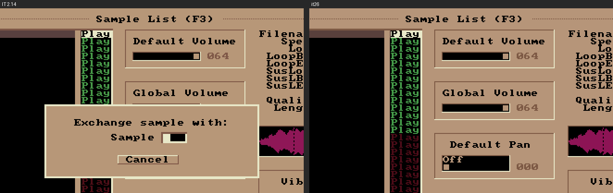

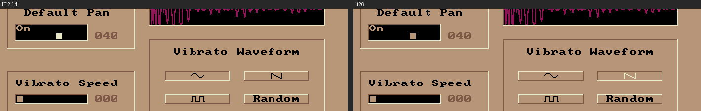

## M2 — Pattern editor

`IT_PE.ASM` registers no mouse events: in IT 2.14 a click into the
pattern does nothing, a drag marks nothing. it26's `pattern_click` moves
the cursor to the clicked cell and column. A port addition -- keep as a
documented extension or remove.

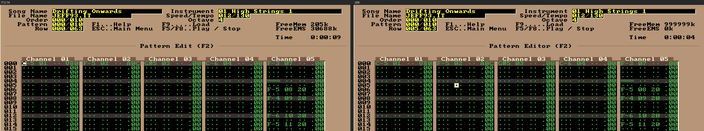

## M3 — F11 order list

IT ignores a click into the order list (the cursor stays on 000); it26
moves the cursor to the clicked digit.

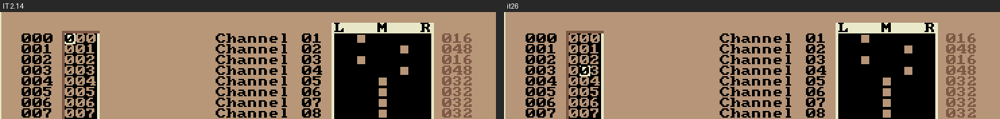

## M4 — File screens

`IT_DISK.ASM` has no mouse events: on F9 / F10 (and the Load Sample /
Load Instrument screens) IT 2.14 ignores clicks. it26 selects the clicked
file, drive or field.

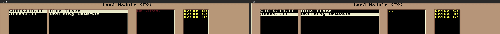

## M5 — Click on a muted channel

IT's pan bars write the value as is (`SetPanning`), so a click on a muted
channel's "Muted" sets a pan of 0..64 and the mute is gone. it26 keeps
the mute bit.

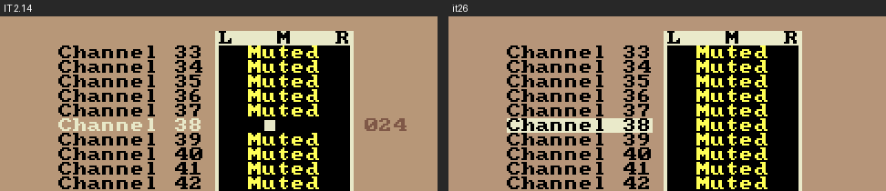

## M6 — F11 channel label

The label of the selected channel ("Channel 04") is 23h in IT, 30h in
it26.

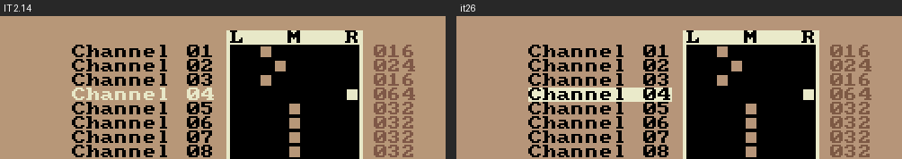

## M7 — Menu focus on a click

After a click on "Playback Menu...", IT's main menu still shows "File
Menu..." (the keyboard focus) with its 23h label; it26 moved the
selection to the clicked item.

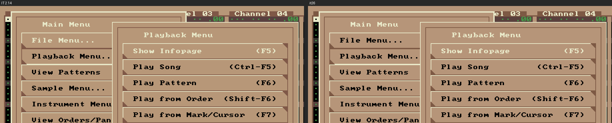

## M8 — Header tempo

After a click into F12's tempo bar (192), it26's header reads 006/192;
IT's header keeps the current tempo, 006/125.

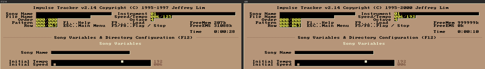

## M9 — "Initialise instruments?"

Clicking "Instruments" on F12: IT asks with OK / No and its header still
says "Sample"; it26 shows OK / Cancel and "Instrument".

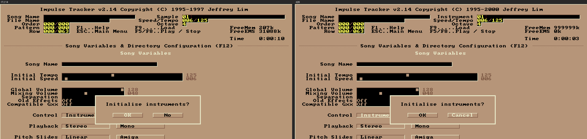

## M10 — Envelope click

A click into the volume envelope inserts a node at that tick/value in IT
("Node 2/4, Tick 87, Value 36"); it26 changed node 0 (value 28, still
three nodes).

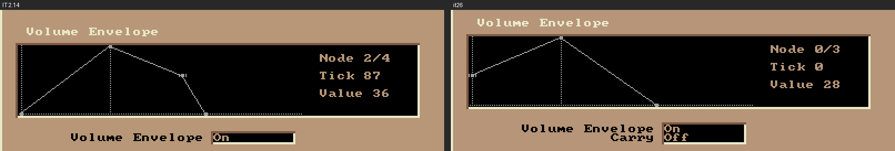

## M11 — Toggle hit area

On F4's Panning page a click at column 60 of the "Default Pan" row
switches the toggle in it26; IT only reacts on the toggle's text.

